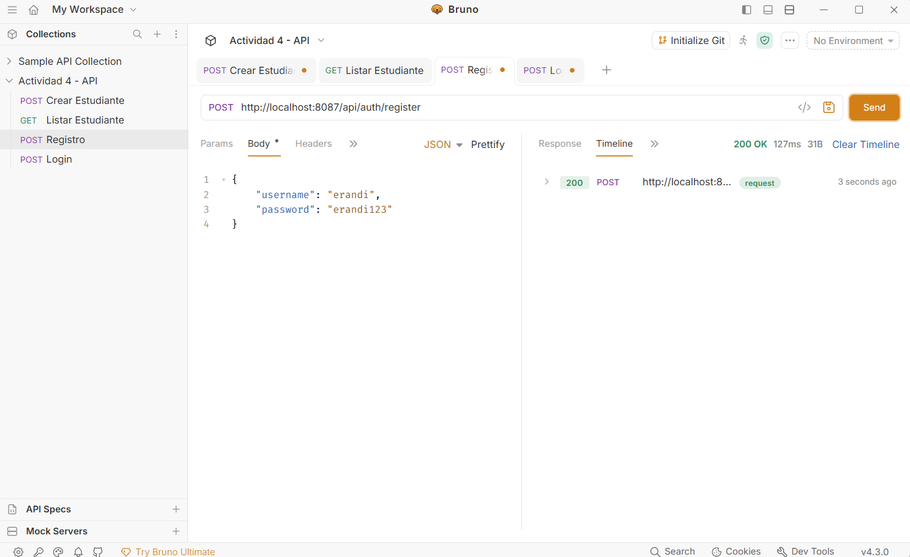
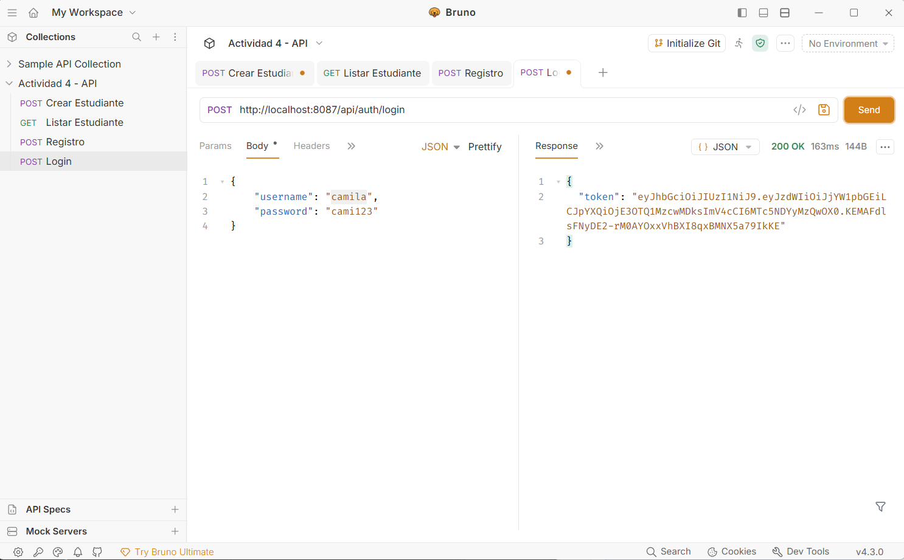
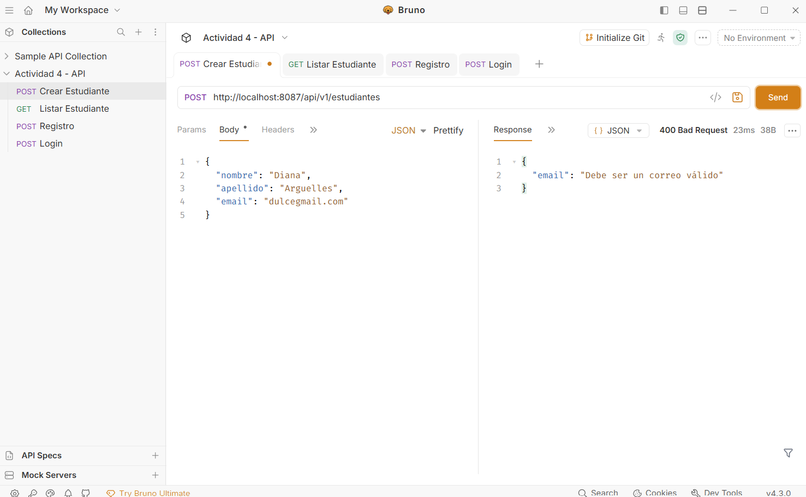
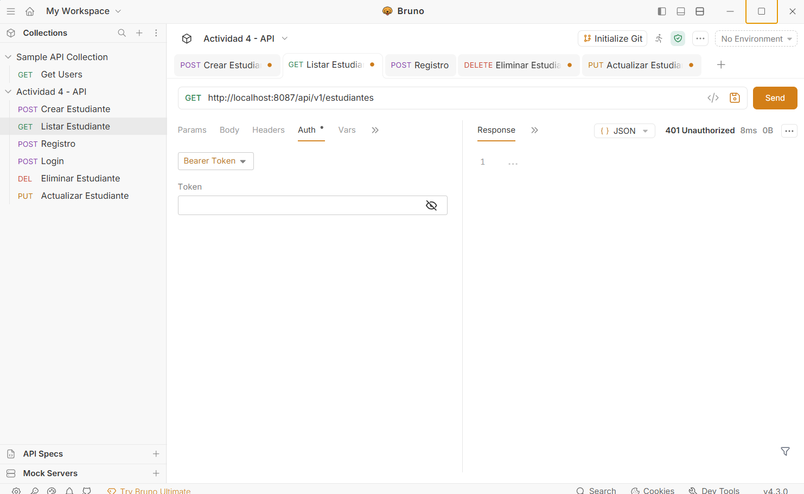
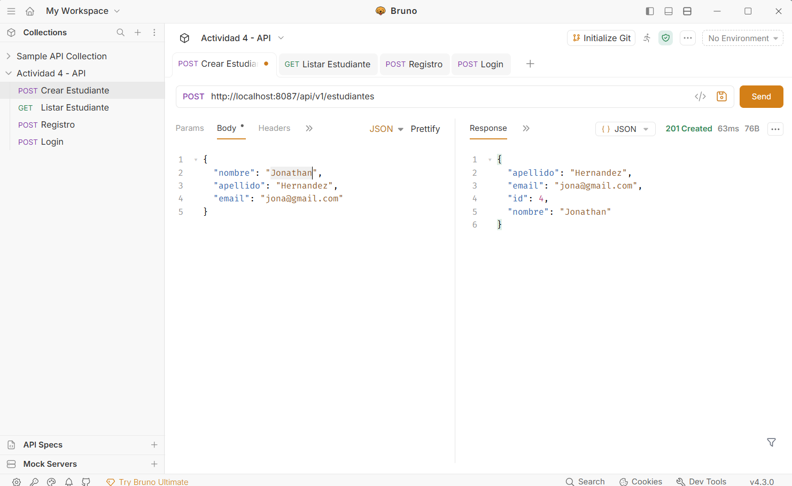
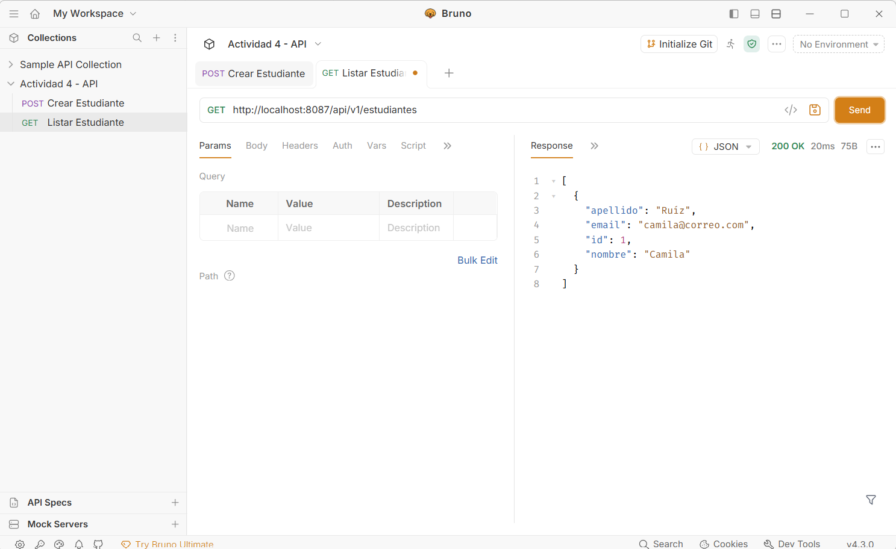
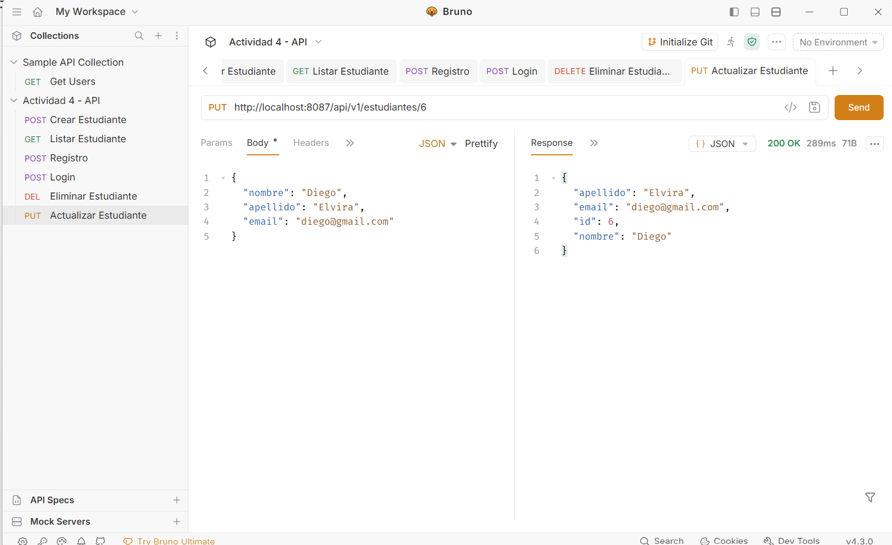
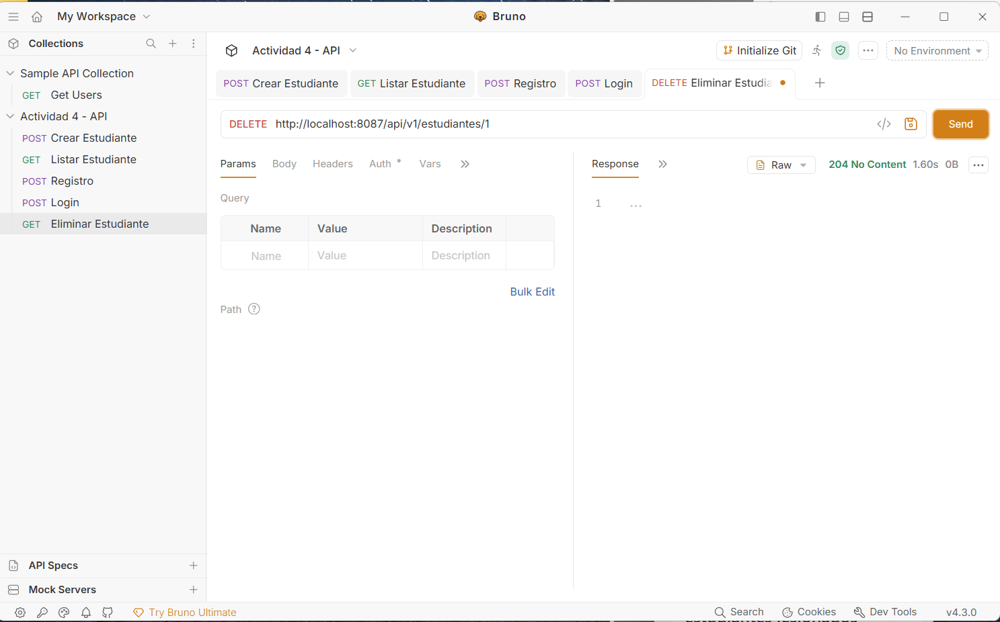

# Actividad 4 - API REST con Spring Security y JWT

**Erandi Camila Ruíz Jiménez**

## Descripción
API REST pura (sin vistas) para la gestión de estudiantes, con autenticación real basada en JWT (JSON Web Tokens), validación de datos de entrada con DTOs y protección de endpoints.

## Tecnologías Utilizadas
*   **Lenguaje:** Java 21
*   **Framework:** Spring Boot (v4.1.2)
*   **Seguridad:** Spring Security + JJWT (JSON Web Token)
*   **Persistencia:** Spring Data JPA / Hibernate
*   **Base de Datos:** MySQL / MariaDB
*   **Validación:** Bean Validation (Jakarta Validation)
*   **Herramienta de Pruebas API:** Bruno
*   **Servidor en la nube:** AWS EC2

---

## Arquitectura de Seguridad (¿Cómo funciona?)
Para proteger la API, se implementó un flujo de seguridad sin estado (Stateless) usando JWT:
1.  **Registro y Login:** El usuario se registra e inicia sesión. El servidor valida las credenciales y genera un token JWT firmado.
2.  **Filtro de Seguridad:** Se creó un `JwtAuthenticationFilter` que intercepta cada petición HTTP. Este filtro busca el token en el header `Authorization: Bearer <token>`. Si el token es válido, autentica al usuario en el contexto de Spring Security.
3.  **Configuración (`SecurityConfig`):** Se definieron rutas públicas (`/api/auth/**`) para permitir el registro y login. Todas las demás rutas (el CRUD) requieren estar autenticado.

## Uso de DTOs y Validación
No se exponen las entidades directamente. Se utilizan dos DTOs:
*   `EstudianteRequest`: Recibe los datos del cliente. Incluye validaciones como `@NotBlank` (campos obligatorios) y `@Email` (formato de correo válido).
*   `EstudianteResponse`: Devuelve los datos al cliente, ocultando información interna.
*   **Manejo de Errores:** Un `GlobalExceptionHandler` captura los errores de validación (`@Valid`) y los devuelve en un JSON claro con un status HTTP 400 (Bad Request).

---

## Evidencias del Proyecto

### 1. Registro de Usuario

### 2. Login y Generación de Token

### 3. Validación de Datos (Error 400)
Petición con correo inválido rechazada por `@Valid`.

### 4. Acceso Denegado sin Token (Error 401)
Petición al CRUD sin el Bearer Token.

### 5. CRUD Protegido con Token (200 OK / 201 Created)
Peticiones exitosas enviando el token en el header `Authorization`.

### 6. GET (Listar) 
Peticiones exitosas enviando el token en el header `Authorization`.

### 7. UPDATE (Actualizar) 
Peticiones exitosas enviando el token en el header `Authorization`.

### 8. DELETE (Eliminar)
Peticiones exitosas enviando el token en el header `Authorization`.

---

## Despliegue en el VPS (AWS)
La API se compiló en un archivo `.jar` y se desplegó en una instancia EC2 de AWS, configurando un perfil de producción (`application-prod.properties`) para conectarse a la base de datos MariaDB del servidor. El servicio corre en segundo plano mediante `nohup` en el puerto **8089**.

---

## Enlaces de Entrega
*   **Repositorio GitHub:** [https://github.com/camicrts5-hash/ECRJact4_t4](https://github.com/camicrts5-hash/ECRJact4_t4)
*   **API en VPS:** [http://18.218.44.223:8089](http://18.218.44.223:8089)
*   **Colección de Bruno:** Incluida en la carpeta `/bruno` de este repositorio.